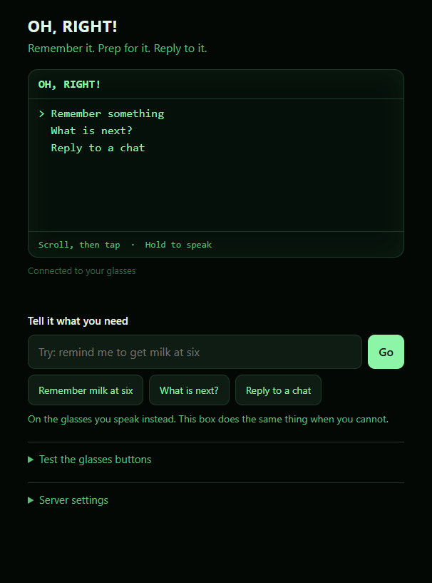

# OH, RIGHT!

Catch it. Prep it. Send it. A voice-first daily assistant for Even Realities G2 glasses, built for the Heads Up hackathon (track: AI Assistants & Work, with Telegram as a core integration).

- **Catch it**: say "remind me to get milk at six". The glasses show the task and time. You confirm, and a Telegram reminder is scheduled.
- **Prep it**: say "what is next?". You get your next calendar event with a one-line prep note.
- **Send it**: pick a Telegram chat, review a one-line summary and an AI draft, speak a change if you want one, then Send or Cancel. Nothing is sent without an explicit tap on Send.
- **Bot commands and pings**: in your private chat with the bot, `/notify on` makes it message you when someone writes in a chat it can see (off by default, at most one ping per chat every 30 seconds). `/mute 60` pauses pings, `/status` shows what is on, `/reminders` lists what is pending and `/help` lists the commands.
- **New message alerts**: while you are on the home menu, a new Telegram message shows as a short card (tap to reply, double tap to dismiss). The app checks the backend every 8 seconds, with no AI call, and an alert never interrupts a task in progress. Verified against the backend feed with live Telegram; the card itself is covered by state-machine tests, not yet by a live simulator run.

Gestures: scroll to move, tap to choose, double tap to go back or cancel, hold (or tap) to speak.

## Hackathon notes

- **Track:** 04 AI Assistants & Work, and the Best Telegram integration prize. Services used: Telegram (bot), Google Calendar (read-only secret iCal feed), and an OpenAI-compatible model (OpenAI or OpenRouter, for example `LLM_BASE_URL=https://openrouter.ai/api/v1`).
- **What existed before Nov 23:** nothing. The code was written during the hackathon. Open-source libraries: Even Hub SDK, Vite, TypeScript, Vitest.
- **Submission text and feature requests:** [docs/SUBMISSION.md](docs/SUBMISSION.md).

## Screenshots




## Run it

```bash
npm install
npm run dev        # backend on :8787, app on :5173
npm run sim        # Even Hub simulator pointed at the app (second terminal)
```

With no configuration the backend runs in **demo mode**: seeded calendar and chats, reminders and replies are logged to the console instead of Telegram, and the built-in parser handles commands. The phone panel (the web page itself) has a text box for "say it" and buttons for every glasses gesture, so the whole flow works without a microphone or glasses.

Copy `.env.example` to `.env` to go live:

| Variable | Effect |
| --- | --- |
| `TELEGRAM_BOT_TOKEN` | Real reminders and replies. Message the bot `/start` (add your token as `/start <APP_TOKEN>` if you set one) to pair the owner chat. The first chat to pair wins, and no other chat can take over later. |
| `LLM_API_KEY`, `LLM_BASE_URL`, `LLM_MODEL` | Any OpenAI-compatible API for smarter intent parsing, chat summaries, drafts and prep notes. |
| `STT_API_KEY`, `STT_BASE_URL`, `STT_MODEL` | Speech to text for the glasses microphone (OpenAI Whisper or Groq). |
| `ICS_URL` | Secret iCal URL for your real calendar (recurring events are not expanded). |
| `APP_TOKEN` | Shared secret the app sends with every request. Required to listen on anything other than localhost. Without it, only localhost pages can call the backend. |

## On real glasses

1. Deploy the backend anywhere that runs Node 20+ (`node server/index.mjs`). Set `APP_TOKEN` first: the server refuses to listen on a public address without one.
2. Put your backend's HTTPS host in the `whitelist` of `app.json`.
3. Build with the backend address baked in: `VITE_API_BASE=https://your-backend npm run pack`. The pack script stops if the whitelist still holds the placeholder. The glasses app has its own storage, so the phone panel's Server settings only affect the browser preview.
4. Use `evenhub login`, then `evenhub create oh-right.ehpk --name "OH, RIGHT!" --tagline "Remember it. Prep for it. Reply to it."`.
5. To test live on a phone before packing, run `npm run qr` with your computer's LAN address instead of localhost (`evenhub qr --url http://<lan-ip>:5173`).

If you build with `VITE_APP_TOKEN`, that token is readable by anyone who unpacks the `.ehpk`. Treat it as a low-value shared secret and keep real credentials (Telegram, LLM, calendar) on the server only.

## Hosting the backend

The backend has no dependencies, so any host that runs Node or Docker works. The repo includes a `Dockerfile` and a `render.yaml` for Render.

1. On Render, choose New, then Blueprint, and select this repo. It creates a web service with a 1 GB disk at `/data` for the reminder and pairing store, and generates an `APP_TOKEN`.
2. Fill in `TELEGRAM_BOT_TOKEN`, `LLM_API_KEY` and `STT_API_KEY` when asked. The model and speech settings are already in the blueprint.
3. Stop any local backend first. Telegram lets only one program read a bot's messages.
4. Build the glasses app with the host address and token: `VITE_API_BASE=https://<service>.onrender.com VITE_APP_TOKEN=<token> npm run pack`.

A free plan sleeps when idle, which stops Telegram polling and reminders, so the blueprint uses the always-on Starter plan. The container was not run in Docker here; the same environment was checked locally with the token, host and store path set.

## Design notes

- `app/src/machine.ts` is a pure state machine (screen + input in, screen + effects out). `runtime.ts` runs the effects against the SDK and the API. Results from a cancelled step are discarded, so a late response never changes the screen.
- Safety: the backend refuses `/api/send` unless `confirmed: true`; chat text is passed to the model as untrusted data; incoming Telegram messages are held in memory for 60 minutes only (sample chats in demo mode do not expire); no API keys exist in the glasses app; reminder and send requests carry client ids so a retry never duplicates.
- Every screen is clipped to what fits on the 576x288 display.

## Tests

`npm test` runs 123 tests: the time/intent parser, the state machine, the backend over HTTP, Telegram pairing and store recovery, the LLM paths against a fake OpenAI-compatible API, voice capture (hold to talk, tap to talk, too-short audio, silence, speech-service outage, cancel) and the runtime against a fake glasses bridge.

## Voice

The glasses microphone sends 16 kHz, 16-bit mono PCM frames. The app buffers them while you hold (or tap) to talk, wraps them in a WAV and posts them to `/api/stt`, which forwards them to any OpenAI-compatible `/audio/transcriptions` endpoint. The transcript then goes to the parser. Tests check that the uploaded bytes are exactly what the microphone sent. I also ran synthesized speech through a real recognizer (Windows speech recognition), which routed "what is next" and "messages to reply to" correctly and turned "remind me to get milk at six" into a reminder. I then ran recorded speech through Groq Whisper (`whisper-large-v3-turbo`), which returned "Remind me to get milk at 6.", "What is next?" and "Do I have any messages to reply to?". Whisper accuracy with a real G2 microphone is untested.

## Not verified yet

Verified outside the simulator: real Telegram delivery in both directions (bot pairing, a reminder, and a group reply), AI summaries and drafts through OpenRouter, and Whisper transcription of recorded speech. Not verified: physical G2 hardware (microphone format, event types) and live calendar. The simulator run covered Prep it, Send it, hold-to-speak and error recovery in demo mode.


## Business mode and lens reminders

- Telegram Business mode (Premium): connect @ohalrightbot under Settings > Business > Chatbots so it can see your private chats and reply as you. Untested live; covered by unit tests.
- Due reminders show on the lens as a card: tap = got it, double tap = snooze 10 min.
- Home shows "(N new)" for unread chats.
- "Other reply" cycles two alternative drafts. Telegram voice notes are transcribed (needs the speech key). Replies are threaded to the last message.
